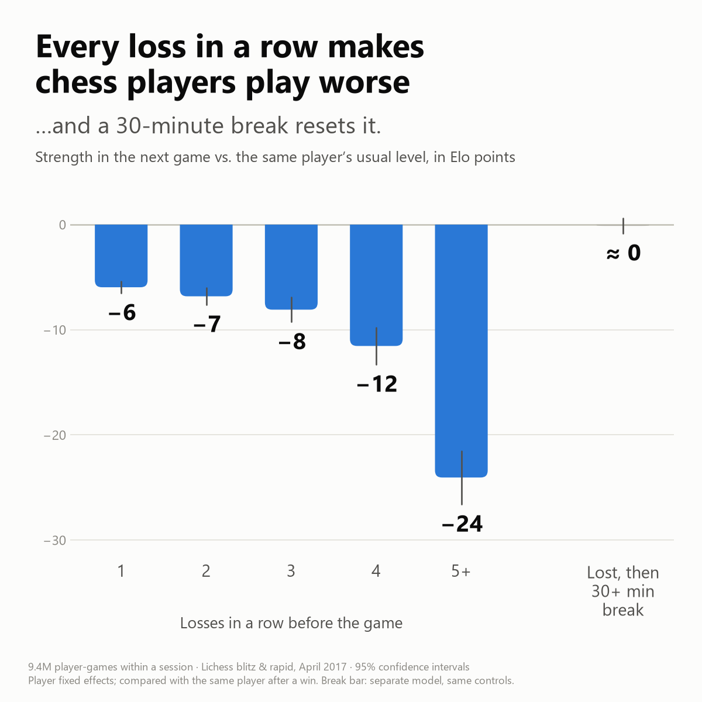
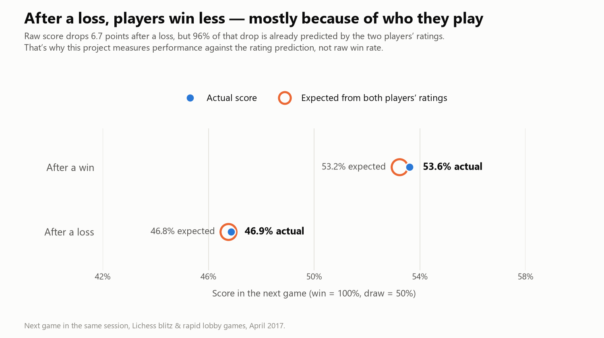
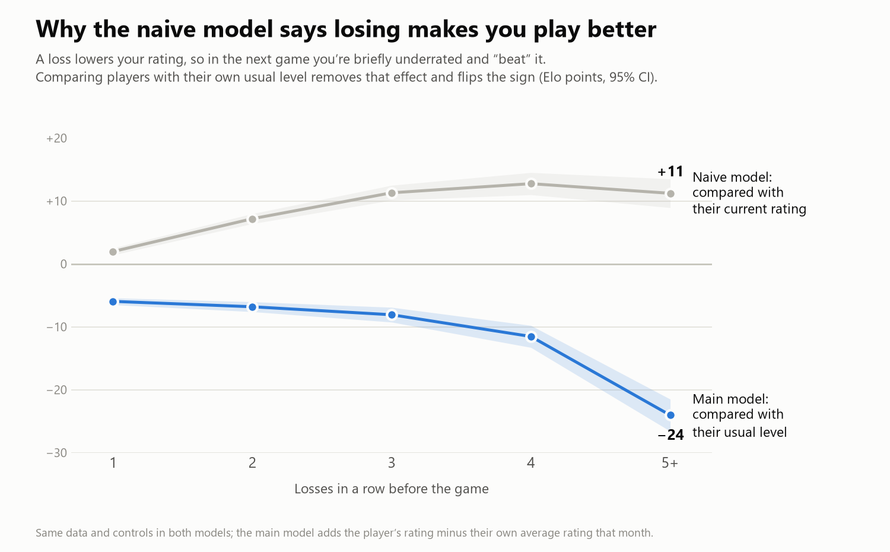

# Tilt: do chess players play worse after losing?

**Yes. After a loss, online chess players play about 7 rating points below their usual level in their next game. After five losses in a row it's 24 points, and a 30-minute break wipes the effect out.**

I measured this on 11.3 million rated games from the [Lichess open database](https://database.lichess.org) (April 2017), comparing each player with themselves.



## Key findings

| | Effect on the next game | 95% CI |
|---|---:|---|
| After a loss (vs. after a win) | **−7 Elo** | −7.4 to −6.4 |
| After 1 / 2 / 3 / 4 losses in a row | −6 / −7 / −8 / −12 Elo | |
| After 5+ losses in a row | **−24 Elo** | −26.6 to −21.5 |
| After a loss followed by a 30+ minute break | **−0.1 Elo** (not significant) | −0.8 to +0.6 |

*"Elo" here means: how much weaker a player would need to be to score that much less against an equal opponent. Based on 9.4 million player-games by 164,595 players, within playing sessions.*

1. **Losses stack up.** One loss costs about 6 rating points of strength; five in a row cost 24. The effect builds over a session rather than reacting to a single game.
2. **A break resets it.** Requeuing within a minute after a loss carries the full effect; after a break of 30+ minutes it is indistinguishable from zero. The difference between the two is 6.5 Elo (95% CI 5.5 to 7.4).
3. **Weaker players are hit hardest.** After a loss: −16 Elo for players under 1200, −10 for 1200–1600, −7 for 1600–2000, and no significant drop for 2000+ (though even they lose 11 points after five straight losses). Rapid players are affected more than blitz players (−9.6 vs −4.6 Elo).
4. **People rush back in at exactly the wrong moment.** Comparing each player with themselves, a loss makes them 5.6 percentage points *less* likely to keep playing, but 1.9 points *more* likely to start a new game within a minute. In blitz, 56% of games after five straight losses are followed by a new game within a minute, against 43% after a win.

The interactive dashboard lets you enter your own rating and see the effect for your level (`streamlit run app/streamlit_app.py`, see [How to run](#how-to-run)).

## Why this needed care

**Raw win rates are misleading.** Players score 6.7 percentage points less after a loss than after a win, but 96% of that gap is predicted by the ratings alone: after a loss you often face a stronger opponent (rematches, for example). So every result here is measured against the rating prediction, not raw win rate.



**The first model got the sign wrong.** Comparing each player's games after a loss with their games after a win, the straightforward model says players do *better* after losing (+4.4 Elo). That's an artifact of how ratings work: a loss lowers your rating immediately, but your actual skill hasn't changed, so in the next game you are briefly underrated and "beat" the prediction. Comparing players with their own usual level (their average rating that month) removes this and flips the result.



## Method

1. **Data.** Every rated standard game on Lichess in April 2017: 11,348,506 games by 228,760 players. Downloaded as a compressed PGN file and stream-parsed without loading it into memory; the file's checksum is verified against Lichess's published list.
2. **Game timelines.** Each player's games are put in time order. Clock times in the move text tell us when each game's last move was played, so we know how long a player waited before the next game. A break of 30+ minutes starts a new session; losing streaks are counted within a session.
3. **Sample.** Rated blitz and rapid games (classified from the time control), finished normally, both players moved. Normal "lobby" games only; tournament games, where the next opponent is assigned automatically, are checked separately.
4. **Outcome.** Performance residual = actual score − expected score from both players' ratings (1 for a win, 0.5 for a draw).
5. **Model.** Linear regression with **player fixed effects** (each player compared with themselves) and standard errors **clustered by player**. Controls: playing White, blitz vs. rapid, how many games into the session, the opponent's own last result, and the player's current rating minus their own monthly average.
6. **Cool-down test.** The loss effect is estimated separately by how long the player waited before the next game (<1, 1–5, 5–30, 30+ minutes).

Every methodological choice, with the reasoning and the evidence behind it, is in [`docs/decisions.md`](docs/decisions.md).

### Robustness

With the rating control in place, the loss effect stays negative and statistically significant (p < 0.001) in every check:

| Check | Loss effect (Elo) | Quick restart vs. 30+ min break (Elo) |
|---|---:|---:|
| Main result | −6.9 | −6.5 |
| Rating vs. previous 20 games only (no look-ahead) | −3.7 | −9.1 |
| Players with 20+ games | −7.5 | −5.2 |
| Blitz only / rapid only | −4.6 / −9.6 | −4.2 / −10.5 |
| Tournament games only | −8.3 | −9.7 |
| Previous game at the same speed | −6.8 | −6.1 |
| Excluding rematches | −8.7 | −10.1 |
| Standard errors clustered by both players | −6.9 | −6.5 |

Because the main rating control uses the player's average over the whole month (which includes later games), the honest range for the loss effect is **about 4 to 7 Elo**.

**Placebo test.** For games 3+ in a session, a loss two games back matters about as much (−5.0 Elo) as the most recent loss (−4.5 Elo). That's why I describe the effect as building up over a session rather than as a reaction to one game.

## Limitations

- **Tilt or a bad day?** Emotional tilt and simply having an off day look the same in this data: both produce losses followed by weaker play that ends when you stop. The data can't separate them. The practical advice, take a break, holds either way.
- **Who keeps playing.** Performance after a loss is only observed for players who chose to continue. Players who quit after losing might be the most tilted ones, which would make the true effect larger.
- **One month, 2017.** Lichess had no separate rapid rating then, and player behaviour may have changed since. Casual games and chess variants aren't in the dataset, so a player's true previous game is occasionally missing.
- **Approximations.** Lichess uses Glicko-2 ratings; the expected score uses the standard Elo formula, and "Elo points" convert score differences at an even match. Game end times come from clock data and can be off by a few seconds.
- **Many subgroups.** The rating-band and time-control breakdowns are descriptive; with many comparisons, a single borderline result shouldn't be over-read.

## Business implications

For a platform like Lichess or Chess.com, these results point to a simple, testable product idea: **a cool-down nudge after losing streaks.**

- **When:** after 3+ losses in a row within a session, the point where the effect clearly grows (−8 Elo after three losses, −24 after five).
- **What:** a light prompt ("Three losses in a row. Players who take a short break usually come back at full strength."), not a block.
- **Why it could pay off:** players who requeue on tilt keep losing, which feels bad and can push them to quit for good. A nudge that converts some rage-queues into short breaks could improve how players feel about the platform, and keep ratings more accurate (games played while tilted pull ratings away from true skill).
- **How to know:** run an A/B test. Randomly show the nudge, then compare next-game performance against the rating prediction, session length, and 7- and 30-day retention. This data shows the problem; only an experiment can show whether a nudge fixes it without hurting engagement.

## How to run

Requires Python 3.11+ and about 5 GB of free disk space.

```bash
python -m venv .venv
.venv\Scripts\activate            # macOS/Linux: source .venv/bin/activate
pip install -r requirements.txt

python src/download.py     # ~3.5 GB download from database.lichess.org, checksum-verified
python src/parse.py        # stream-parse to data/processed/games.parquet (~6 min)
python src/features.py     # player timelines, sessions, streaks, residuals (~1 min)
python src/analysis.py     # descriptive tables, fixed-effects models, robustness -> results/ (~20 min)
python src/charts.py       # figures/*.png

streamlit run app/streamlit_app.py   # interactive dashboard (reads results/ only)
pytest                               # parser, feature, statistics and dashboard tests
```

`results/` and `figures/` are committed, so the dashboard and charts work without downloading the data.

## Repository structure

```
src/
  download.py         fetch one month from Lichess, verify checksum
  parse.py            stream .pgn.zst -> games.parquet (regex parser, benchmarked against python-chess)
  features.py         player timelines, sessions, streaks, residuals (DuckDB SQL)
  analysis.py         fixed-effects models and robustness checks -> results/*.csv
  charts.py           figures/*.png
  benchmark_parse.py  parser speed and accuracy check
app/streamlit_app.py  dashboard
notebooks/            exploration and sanity checks
results/              every number reported here
figures/              charts
docs/decisions.md     every methodological decision and why
tests/                pytest suite
```

## About

Built by Roman Breytenbikher, a business administration student studying data science. Data: Lichess open database, released under CC0.
